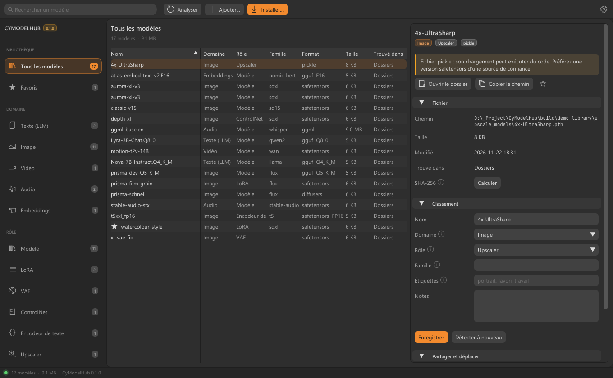

<table width="100%">
  <tr>
    <td width="300" align="left" valign="top">
      <a href="Documentation/Documentation.html#/fr/overview">Manuel utilisateur</a><br>
      <a href="BUILD.md">Compilation</a><br>
      <a href="docs/API.md">Opérations du service</a><br>
      <a href="docs/INTEGRATION.fr.md">Intégration d'une application</a><br>
      <a href="VERSION.fr.md">Notes de version</a><br><br>
      <sub>README</sub><br>
      <a href="README.md">English</a> · <a href="README.fr.md">Français</a>
    </td>
    <td width="400" align="center" valign="middle">
      <br>
      <h1>CyModelHub</h1>
    </td>
    <td width="300" align="right" valign="top">
      <p><sub>Licence</sub><br><a href="LICENSE"><strong>GPL-3.0-only</strong></a><br><sub>bibliothèque cliente : <a href="LICENSE-MIT">MIT</a></sub></p>
      <p><sub>Version</sub><br><a href="VERSION.fr.md"><strong>0.1.1</strong></a><br><strong>EN DÉVELOPPEMENT</strong></p>
      <p><sub>Plateforme vérifiée</sub><br><a href="https://github.com/MrMybal/CyModelHub/releases/latest">Télécharger pour Windows x64</a></p>
    </td>
  </tr>
</table>

**Un seul catalogue des modèles d'IA installés sur votre ordinateur, partagé par toutes les
applications.** Installez un modèle une fois ; chaque programme qui interroge CyModelHub le
retrouve, au lieu de télécharger et de stocker sa propre copie.

> **EN DÉVELOPPEMENT · 0.1.1** — compilé et testé sous Windows x64. Le code pour Linux et
> macOS est écrit mais n'a pas encore été compilé ni exécuté. Voir les
> [notes de version](VERSION.fr.md).

[](docs/screenshots/models.fr.png)

## Ce qu'il fait

- **Il retrouve les modèles déjà présents.** Le cache Hugging Face et les dépôts locaux
  d'Ollama et de LM Studio sont lus automatiquement ; ajoutez n'importe quel autre dossier
  (ComfyUI, un disque de modèles) pour le surveiller aussi.
- **Il comprend ce qu'est chaque fichier.** Modèles de langage, diffusion d'images et de
  vidéos, audio, embeddings, LoRA, VAE, ControlNet, encodeurs de texte, upscalers. Les
  en-têtes GGUF et safetensors sont lus (architecture, quantification, longueur de contexte,
  modèle de base) ; un dossier Diffusers, Transformers ou MLX compte pour un modèle. Les
  poids ne sont jamais chargés et les fichiers pickle ne sont jamais ouverts. La détection
  fait au mieux : corrigez-la à la main et votre choix est conservé.
- **Il répond aux applications.** « Où est `sd_xl_base_1.0` ? » renvoie le chemin du fichier
  installé, à partir d'un nom, d'un nom de fichier, d'un dépôt, d'un SHA-256 ou d'un
  identifiant.
- **Il gère les fichiers.** Étiquettes, notes et favoris ; doublons et place qu'ils
  gaspillent ; déplacement d'un modèle vers un autre disque ; lien physique ou symbolique
  pour le rendre visible dans le dossier d'une autre application, sans le copier.
- **Il installe des modèles.** Depuis un dépôt Hugging Face ou une adresse HTTPS, avec
  progression, reprise et vérification du SHA-256.
- **Il partage une seule installation entre les applications.** Plusieurs programmes qui
  demandent le même modèle au même moment obtiennent un seul téléchargement et une seule
  copie ; une demande envoyée deux fois n'a qu'un effet.
- **Il connaît les modèles complets.** Un modèle fait de plusieurs fichiers (poids, fragments,
  configuration, tokenizer, manifeste) n'est annoncé prêt que lorsque chaque fichier
  obligatoire est présent et contrôlé. Une application peut aussi enregistrer, là où il se
  trouve, un modèle qu'elle a téléchargé elle-même.
- **Il fonctionne avec les assistants IA.** Chaque opération est aussi un outil MCP.

CyModelHub ne supprime jamais un fichier de modèle. Il n'écrit que dans les emplacements que
vous avez enregistrés.

## Les composants

| Programme | Rôle |
| --- | --- |
| `CyModelHubService` | Le service local qui possède le catalogue. Un par utilisateur, démarré à la demande, joignable uniquement sur la boucle locale, avec un jeton d'accès. |
| `CyModelHub` | L'application de bureau ([CyUI](https://github.com/MrMybal/CyUI)), en français et en anglais. Elle utilise la même bibliothèque cliente que tout autre programme. |
| `CyModelHub::Client` | La bibliothèque C++ qu'une application lie pour retrouver et gérer les modèles. |
| `CyModelHubMcp` | Serveur MCP stdio pour les clients IA qui lancent une commande. Le service expose aussi MCP en HTTP. |
| `CyModelHubCli` | Accès en ligne de commande pour les scripts et les vérifications rapides. |

## L'utiliser depuis votre application (C++)

```cmake
add_subdirectory(external/CyModelHub)   # intégré, seul le client est compilé
target_link_libraries(my_app PRIVATE CyModelHub::Client)
```

```cpp
#include <cymodelhub/client.hpp>

cymodelhub::Client hub;                                   // démarre le service au besoin
if (auto model = hub.resolve("sd_xl_base_1.0", "model", "image"))
    load(model->path);                                    // déjà installé : on l'utilise
else
    hub.invoke("install_start", {{"repository", "stabilityai/stable-diffusion-xl-base-1.0"},
                                 {"file", "sd_xl_base_1.0.safetensors"}});

cymodelhub::Query loras;                                  // les LoRA faits pour SDXL
loras.type = "lora";
loras.architecture = "sdxl";
for (const auto& lora : hub.list(loras)) show(lora.name, lora.path);
```

La bibliothèque est sous licence MIT, demande C++20 et est autonome : elle utilise la
bibliothèque standard C++, le système d'exploitation et la copie de
[nlohmann/json](https://github.com/nlohmann/json) (MIT) rangée dans `third_party`. L'ajouter à
votre projet ne télécharge rien. Si votre projet définit déjà la cible
`nlohmann_json::nlohmann_json` avant d'ajouter CyModelHub, c'est cette copie qui est utilisée.
Un exemple complet se trouve dans [examples/client](examples/client). Le service est cherché
via `CYMODELHUB_SERVICE`, à côté de votre programme, ou là où il a tourné la dernière fois.

### Un modèle précis

`resolve()` trouve le nom le plus proche, ce qui convient à une personne. Une application qui a
besoin d'un modèle précis utilise le parcours strict : elle dit quel modèle, ce qu'il doit être
et quels fichiers elle ouvre, et reçoit une réponse explicite au lieu d'un modèle ressemblant.

```cpp
cymodelhub::Requirement need;
need.repository = "org/name";
need.revision   = "<commit>";
need.files      = {{"model.gguf", 4368439584, "<sha256>"}};

auto found = hub.check(need);
if (found.ready())
    load(found.entry);                          // le fichier partagé : ne jamais le copier
else if (found.status == cymodelhub::Availability::absent ||
         found.status == cymodelhub::Availability::installing)
    load(hub.wait(hub.install(request)).path);  // rejoint une installation déjà en cours
else
    report(found.status_name, found.reasons);   // incomplet, invalide, incompatible, ambigu...
```

Le guide [Intégration d'une application](docs/INTEGRATION.fr.md) décrit tout le parcours :
résolution stricte, modèles complets, rejoindre une installation, enregistrer un modèle que
l'application a téléchargé, demandes qui peuvent être envoyées deux fois, et le sens de chaque
réponse. [examples/client/ensure_model.cpp](examples/client/ensure_model.cpp) est ce parcours
sous forme de programme.

N'importe quel langage peut parler directement au service : lisez `service.json` dans le
dossier de données de CyModelHub (`url`, `token`), puis `POST <url>/v1` avec
`Authorization: Bearer <token>` et
`{"method":"invoke","name":"models_resolve","arguments":{"query":"..."}}`.
[Toutes les opérations](docs/API.md) (en anglais).

## L'utiliser depuis un assistant IA (MCP)

Dans l'application, **Réglages → Copier la configuration MCP** donne la configuration HTTP,
jeton compris. Pour un client qui lance une commande, indiquez-lui `CyModelHubMcp` :

```json
{ "mcpServers": { "cymodelhub": { "command": "/chemin/vers/CyModelHubMcp" } } }
```

L'assistant dispose alors de `models_list`, `models_resolve`, `models_update`,
`install_start`, `roots_add` et des autres [opérations](docs/API.md).

## Ligne de commande

```sh
CyModelHubCli list --type lora          # les LoRA installés
CyModelHubCli where sd_xl_base_1.0      # chemin de la meilleure correspondance installée
CyModelHubCli add-root /data/models     # surveiller un dossier
CyModelHubCli install TheOrg/Model-GGUF model.Q4_K_M.gguf
```

## Langues

Le texte de l'interface est en anglais dans le code et traduit par de simples fichiers JSON
dans [locales](locales). Pour ajouter une langue, copiez `fr.json`, traduisez les valeurs et
déposez le fichier à côté des autres : il apparaît dans **Réglages → Langue**.
`python scripts/check_locales.py` liste les entrées manquantes.

---

## Installation

Téléchargez et lancez l’installateur Windows x64 de la [dernière version](https://github.com/MrMybal/CyModelHub/releases/latest).
Il installe CyModelHub pour l’utilisateur courant et crée un raccourci dans le menu Démarrer.
Le service démarre au besoin. L’icône
CyModelHub dans la zone de notification Windows donne accès aux **Réglages**.
Appuyez sur **F1** ou choisissez
**Réglages → Manuel utilisateur (F1)** pour consulter le manuel bilingue hors ligne.
Vous pouvez aussi ouvrir [Documentation.html](Documentation/Documentation.html#/fr/overview)
depuis une copie locale du dépôt ou du dossier installé. Laissez `DocData` à côté du fichier HTML.

Si vous utilisez la version portable 0.1.0, quittez-la
depuis la zone de notification, attendez la fin des tâches et lancez `CyModelHubCli stop`
avant d’ouvrir l’installateur. À partir de la 0.1.1, ouvrez **Réglages → Mises à jour de
l’application → Vérifier les mises à jour** pour trouver les installateurs récents sur
GitHub. CyModelHub vérifie le SHA-256 du fichier avant de proposer son installation.
Les mises à jour conservent le catalogue et les réglages.

## Compilation

```powershell
./scripts/build.ps1        # Windows : service, client, CLI, relais MCP, application, tests
```

Les [instructions pour Windows, Linux et macOS](BUILD.md) expliquent comment utiliser le
CMake livré avec Visual Studio s’il est absent de votre `PATH`.

---

## Licence

Copyright (c) 2026 Cyberalien.

- **Le service, l'application de bureau, l'outil en ligne de commande et le relais MCP** sont
  distribués sous licence [GPL-3.0-only](LICENSE).
- **La bibliothèque cliente** — `include/cymodelhub/client.hpp`, `src/client.cpp`,
  `src/platform.*`, le fichier `CMakeLists.txt` à la racine et `examples/client` — est distribuée sous licence
  [MIT](LICENSE-MIT). Toute application, libre ou propriétaire, peut la lier selon les
  termes de la licence MIT ; elle joint le service comme un programme distinct, en HTTP local.
  Elle inclut nlohmann/json (`third_party/nlohmann`, MIT). Conservez les deux mentions de
  copyright et de permission dans votre distribution.

### Composants tiers

La compilation de l’application de bureau copie les notices de ses dépendances dans `licenses/`.
La notice du lecteur hors ligne se trouve dans `Documentation/DocData/`.

| Composant | Licence | Utilisation |
| --- | --- | --- |
| [CyUI](https://github.com/MrMybal/CyUI) | [MIT](https://github.com/MrMybal/CyUI/blob/e8ccec0a96ed820fc46e86059e010efafcef687e/LICENSE) | Composants de l’interface de bureau |
| [Dear ImGui](https://github.com/ocornut/imgui) | [MIT](https://github.com/ocornut/imgui/blob/master/LICENSE.txt) | Interface en mode immédiat et intégration SDL3 |
| [JetBrains Mono](https://github.com/JetBrains/JetBrainsMono) | [OFL-1.1](https://github.com/JetBrains/JetBrainsMono/blob/master/OFL.txt) | Police à chasse fixe fournie par CyUI |
| [SDL3](https://github.com/libsdl-org/SDL) | [Zlib](https://github.com/libsdl-org/SDL/blob/683181b47cfabd293e3ea409f838915b8297a4fd/LICENSE.txt) | Fenêtre, entrées et rendu de l’application |
| [CyMCPSDK](https://github.com/MrMybal/CyMCPSDK) | [MIT](https://github.com/MrMybal/CyMCPSDK/blob/e562c731a146d599e3404718ea8414bb5b96b66d/LICENSE) | Serveur HTTP local, téléchargements et MCP du service |
| [nlohmann/json](https://github.com/nlohmann/json) | [MIT](third_party/nlohmann/LICENSE.MIT) | Types JSON et sérialisation ; copie dans `third_party/nlohmann` |
| [cpp-httplib](https://github.com/yhirose/cpp-httplib) | [MIT](https://github.com/yhirose/cpp-httplib/blob/master/LICENSE) | Serveur HTTP local du service, via CyMCPSDK |
| [PicoSHA2](https://github.com/okdshin/PicoSHA2) | [MIT](https://github.com/okdshin/PicoSHA2/blob/master/LICENSE) | Vérification SHA-256 |
| [CyDoc](https://github.com/MrMybal/CyDoc) | [MIT](Documentation/DocData/CyDoc.LICENSE.txt) | Génération et lecture du manuel hors ligne |
| [Inno Setup](https://jrsoftware.org/isinfo.php) | [Licence Inno Setup](https://github.com/jrsoftware/issrc/blob/is-6_7_4/license.txt) | Installation et désinstallation sous Windows |
| Bibliothèques d’exécution Microsoft Visual C++ | [Conditions de redistribution Microsoft](https://learn.microsoft.com/fr-fr/cpp/windows/redistributing-visual-cpp-files?view=msvc-170) | DLL x64 fournies avec l’installateur Windows |
