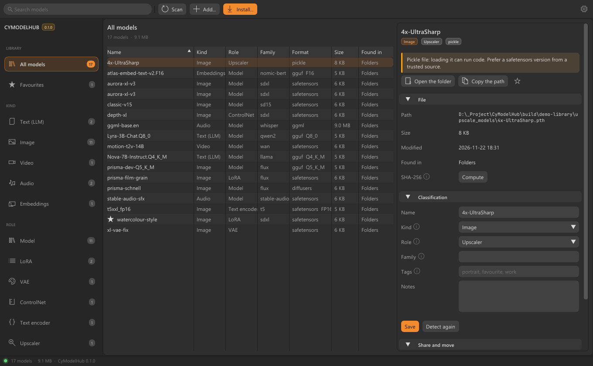

<table width="100%">
  <tr>
    <td width="300" align="left" valign="top">
      <a href="Documentation/Documentation.html#/en/overview">User manual</a><br>
      <a href="BUILD.md">Build</a><br>
      <a href="docs/API.md">Service operations</a><br>
      <a href="docs/INTEGRATION.md">Application integration</a><br>
      <a href="VERSION.md">Release notes</a><br><br>
      <sub>README</sub><br>
      <a href="README.md">English</a> · <a href="README.fr.md">Français</a>
    </td>
    <td width="400" align="center" valign="middle">
      <br>
      <h1>CyModelHub</h1>
    </td>
    <td width="300" align="right" valign="top">
      <p><sub>License</sub><br><a href="LICENSE"><strong>GPL-3.0-only</strong></a><br><sub>client library: <a href="LICENSE-MIT">MIT</a></sub></p>
      <p><sub>Version</sub><br><a href="VERSION.md"><strong>0.1.1</strong></a><br><strong>IN DEVELOPMENT</strong></p>
      <p><sub>Verified platform</sub><br><a href="https://github.com/MrMybal/CyModelHub/releases/tag/v0.1.0">Windows x64 download</a></p>
    </td>
  </tr>
</table>

**One catalogue of the AI models installed on your computer, shared by every application.**
Install a model once; every program that asks CyModelHub finds it, instead of downloading
and storing its own copy.

> **IN DEVELOPMENT · 0.1.1** — built and tested on Windows x64. The Linux and macOS code paths
> are written but have not been compiled or run yet. See the [release notes](VERSION.md).

[](docs/screenshots/models.png)

## What it does

- **Finds the models you already have.** The Hugging Face cache, Ollama and LM Studio stores
  are read automatically; add any other folder (ComfyUI, a models drive) to watch it too.
- **Understands what each file is.** Language models, image and video diffusion, audio,
  embeddings, LoRA, VAE, ControlNet, text encoders, upscalers. GGUF and safetensors headers
  are read (architecture, quantization, context length, base model); Diffusers, Transformers
  and MLX folders count as one model. Weights are never loaded and pickle files are never
  opened. Detection is a best effort: correct it by hand and your choice is kept.
- **Answers applications.** "Where is `sd_xl_base_1.0`?" returns the path of the installed
  file, by name, file name, repository, SHA-256 or ID.
- **Manages the files.** Tags, notes and favourites; duplicates and the space they waste;
  move a model to another drive; make it visible in another application's folder with a hard
  or symbolic link, without copying it.
- **Installs models.** From a Hugging Face repository or an HTTPS address, with progress,
  resume and SHA-256 verification.
- **Shares one installation between applications.** Several programs that ask for the same
  model at the same moment get one download and one copy; a request sent twice has one effect.
- **Knows complete models.** A model made of several files (weights, shards, configuration,
  tokenizer, manifest) is announced ready only when every required file is there and checked.
  An application can also register, where it is, a model it downloaded itself.
- **Works with AI assistants.** Every operation is also an MCP tool.

CyModelHub never deletes a model file. It only writes inside the locations you registered.

## The parts

| Program | Role |
| --- | --- |
| `CyModelHubService` | The local service that owns the catalogue. One per user, started on demand, reachable on the loopback interface only, with an access token. |
| `CyModelHub` | The desktop application ([CyUI](https://github.com/MrMybal/CyUI)), in English and French. It uses the same client library as any other program. |
| `CyModelHub::Client` | The C++ library an application links to find and manage models. |
| `CyModelHubMcp` | MCP stdio server for AI clients that launch a command. The service also serves MCP over HTTP. |
| `CyModelHubCli` | Command line access for scripts and quick checks. |

## Use it from your application (C++)

```cmake
add_subdirectory(external/CyModelHub)   # builds only the client library when embedded
target_link_libraries(my_app PRIVATE CyModelHub::Client)
```

```cpp
#include <cymodelhub/client.hpp>

cymodelhub::Client hub;                                   // starts the service when needed
if (auto model = hub.resolve("sd_xl_base_1.0", "model", "image"))
    load(model->path);                                    // already installed: use it
else
    hub.invoke("install_start", {{"repository", "stabilityai/stable-diffusion-xl-base-1.0"},
                                 {"file", "sd_xl_base_1.0.safetensors"}});

cymodelhub::Query loras;                                  // LoRAs made for SDXL
loras.type = "lora";
loras.architecture = "sdxl";
for (const auto& lora : hub.list(loras)) show(lora.name, lora.path);
```

The library is MIT-licensed, needs C++20 and is self-contained: it uses the C++ standard
library, the operating system and the copy of [nlohmann/json](https://github.com/nlohmann/json)
(MIT) in `third_party`. Adding it to your project downloads nothing. If your project already
defines the `nlohmann_json::nlohmann_json` target before it adds CyModelHub, that copy is used
instead. A complete example is in [examples/client](examples/client). The service is found
through `CYMODELHUB_SERVICE`, next to your program, or where it last ran.

### One exact model

`resolve()` finds the closest name, which suits a person. An application that needs one exact
model uses the strict path: it says which model, what it must be and which files it opens, and
gets an explicit answer instead of a look-alike.

```cpp
cymodelhub::Requirement need;
need.repository = "org/name";
need.revision   = "<commit>";
need.files      = {{"model.gguf", 4368439584, "<sha256>"}};

auto found = hub.check(need);
if (found.ready())
    load(found.entry);                          // the shared file: never copy it
else if (found.status == cymodelhub::Availability::absent ||
         found.status == cymodelhub::Availability::installing)
    load(hub.wait(hub.install(request)).path);  // joins an installation already in progress
else
    report(found.status_name, found.reasons);   // incomplete, invalid, incompatible, ambiguous...
```

[Application integration](docs/INTEGRATION.md) describes the whole path: strict resolution,
complete models, joining an installation, registering a model the application downloaded,
requests that may be sent twice, and what each answer means.
[examples/client/ensure_model.cpp](examples/client/ensure_model.cpp) is that path as a program.

Any language can talk to the service directly: read `service.json` in the CyModelHub data
folder (`url`, `token`), then `POST <url>/v1` with `Authorization: Bearer <token>` and
`{"method":"invoke","name":"models_resolve","arguments":{"query":"..."}}`.
[All operations](docs/API.md).

## Use it from an AI assistant (MCP)

In the application, **Settings → Copy the MCP configuration** gives the HTTP configuration,
token included. For a client that launches a command, point it at `CyModelHubMcp`:

```json
{ "mcpServers": { "cymodelhub": { "command": "/path/to/CyModelHubMcp" } } }
```

The assistant then has `models_list`, `models_resolve`, `models_update`, `install_start`,
`roots_add` and the other [operations](docs/API.md).

## Command line

```sh
CyModelHubCli list --type lora          # installed LoRAs
CyModelHubCli where sd_xl_base_1.0      # path of the best installed match
CyModelHubCli add-root /data/models     # watch a folder
CyModelHubCli install TheOrg/Model-GGUF model.Q4_K_M.gguf
```

## Languages

The interface text is English in the source and translated by plain JSON files in
[locales](locales). To add a language, copy `fr.json`, translate the values and drop the
file next to the others: it appears in **Settings → Language**.
`python scripts/check_locales.py` lists missing entries.

---

## Installation

Download the Windows x64 ZIP from [release 0.1.0](https://github.com/MrMybal/CyModelHub/releases/tag/v0.1.0),
extract the whole folder and run `CyModelHub.exe`. The service starts when needed. Open
**Settings** from the CyModelHub icon in the Windows notification area to go straight to the
settings. Press **F1** or choose **Settings → User manual (F1)**
to open the bilingual offline manual. You can also open
[Documentation.html](Documentation/Documentation.html#/en/overview) from a local copy of the
repository or the installed folder. Keep `DocData` beside the HTML file.

Starting with 0.1.1, the Windows x64 installer installs CyModelHub for the current user
and creates a Start menu shortcut. If you are using 0.1.0, quit it from the notification
area and run `CyModelHubCli stop` after any jobs finish, then run the installer.
In 0.1.1 or later, open **Settings → Application updates → Check for updates** to find
newer installers on GitHub. CyModelHub checks the download against GitHub’s SHA-256
digest before offering to run it. Updates preserve your catalogue and settings.

## Build

```powershell
./scripts/build.ps1        # Windows: service, client, CLI, MCP relay, application, tests
```

[Build instructions for Windows, Linux and macOS](BUILD.md) explain how to use the CMake
shipped with Visual Studio when it is outside your `PATH`.

---

## License

Copyright (c) 2026 Cyberalien.

- **The service, the desktop application, the command line tool and the MCP relay** are
  licensed under [GPL-3.0-only](LICENSE).
- **The client library** — `include/cymodelhub/client.hpp`, `src/client.cpp`, `src/platform.*`,
  the root `CMakeLists.txt` and `examples/client` — is licensed under [MIT](LICENSE-MIT). Any
  application, open or closed, may link it under the MIT terms; it reaches the service as a
  separate program, over local HTTP. It includes nlohmann/json (`third_party/nlohmann`, MIT).
  Keep both copyright and permission notices with your distribution.

### Third-party components

The desktop build copies its dependency notices into `licenses/`. The offline reader ships
its own notice in `Documentation/DocData/`.

| Component | License | Use |
| --- | --- | --- |
| [CyUI](https://github.com/MrMybal/CyUI) | [MIT](https://github.com/MrMybal/CyUI/blob/e8ccec0a96ed820fc46e86059e010efafcef687e/LICENSE) | Desktop UI components |
| [Dear ImGui](https://github.com/ocornut/imgui) | [MIT](https://github.com/ocornut/imgui/blob/master/LICENSE.txt) | Immediate-mode UI and SDL3 backends |
| [JetBrains Mono](https://github.com/JetBrains/JetBrainsMono) | [OFL-1.1](https://github.com/JetBrains/JetBrainsMono/blob/master/OFL.txt) | Monospaced font supplied by CyUI |
| [SDL3](https://github.com/libsdl-org/SDL) | [Zlib](https://github.com/libsdl-org/SDL/blob/683181b47cfabd293e3ea409f838915b8297a4fd/LICENSE.txt) | Desktop window, input and rendering |
| [CyMCPSDK](https://github.com/MrMybal/CyMCPSDK) | [MIT](https://github.com/MrMybal/CyMCPSDK/blob/e562c731a146d599e3404718ea8414bb5b96b66d/LICENSE) | Local HTTP server, downloads and MCP transport of the service |
| [nlohmann/json](https://github.com/nlohmann/json) | [MIT](third_party/nlohmann/LICENSE.MIT) | JSON types and serialization; copy in `third_party/nlohmann` |
| [cpp-httplib](https://github.com/yhirose/cpp-httplib) | [MIT](https://github.com/yhirose/cpp-httplib/blob/master/LICENSE) | Local HTTP server of the service, via CyMCPSDK |
| [PicoSHA2](https://github.com/okdshin/PicoSHA2) | [MIT](https://github.com/okdshin/PicoSHA2/blob/master/LICENSE) | SHA-256 verification |
| [CyDoc](https://github.com/MrMybal/CyDoc) | [MIT](Documentation/DocData/CyDoc.LICENSE.txt) | Offline documentation generator and reader |
| [Inno Setup](https://jrsoftware.org/isinfo.php) | [Inno Setup license](https://github.com/jrsoftware/issrc/blob/is-6_7_4/license.txt) | Windows installer and uninstaller |
| Microsoft Visual C++ Runtime | [Microsoft redistribution terms](https://learn.microsoft.com/en-us/cpp/windows/redistributing-visual-cpp-files?view=msvc-170) | x64 runtime DLLs shipped with the Windows installer |
